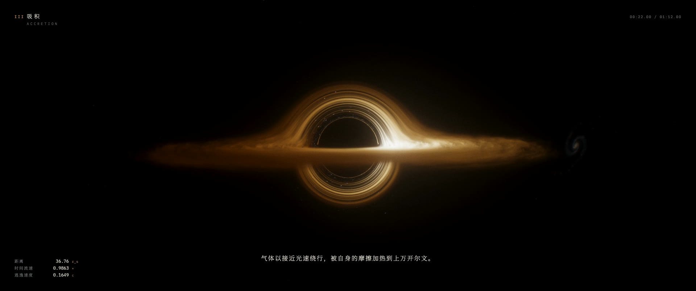

# 视界 · EVENT HORIZON

**▶ 在线体验：https://sundyme.github.io/event-horizon/**　·　[成片](https://sundyme.github.io/event-horizon/film.html)　·　[下载原片](https://github.com/sundyme/event-horizon/releases/latest)



一段 72 秒的实时旅程：从星空深处出发，坠向一个黑洞。画面里的每一束光，都沿史瓦西黑洞周围的弯曲时空逐像素追踪；声音由同一份代码实时合成，与画面同步。整个作品是**一个 HTML 文件**，不依赖任何库，打开网页就能运行。

72 秒结束后自动进入自由视角：拖动环绕，滚轮或双指缩放。

| 按键 | 作用 |
|---|---|
| 空格 | 暂停 / 继续 |
| M | 静音 |
| F | 全屏 |
| H | 隐藏字幕与数据 |
| R | 重播 |
| E | 跳到自由视角 |

## 画面里发生了什么

| 时间 | 幕 | 内容 |
|---|---|---|
| 0–9 s | I 虚空 | 满天星光里，有一块天空不对劲：星星绕着一片虚无扭成光环。 |
| 9–20 s | II 透镜 | 冷尘埃遮出的剪影；13.5 s 吸积盘从内缘向外点燃；16.4 s 背后的旋涡星系被弯成完整的爱因斯坦环，同时响起一段引力波"啁啾"。 |
| 20–27 s | III 吸积 | 盘的背面被引力折到阴影上下，迎面一侧因多普勒效应更亮、更热。 |
| 27–34 s | IV 喷流 | 两道接近光速的喷流从两极射出。 |
| 34–47 s | V 坠落 | 贴着盘面下潜；一个热点绕着最内稳定轨道旋转，它的像环绕着阴影。 |
| 47–60.3 s | VI 视界 | 穿过盘面，55.8 s 越过光子球（1.5 r<sub>s</sub>），回头望：整个宇宙缩成头顶一个越来越蓝的光圈，在视界处硬切到静默。 |
| 60.3–72 s | 尾声 | 从远处回望黑洞，它看起来什么都没发生过。 |

## 真正计算了哪些物理

- **史瓦西时空中的零测地线**：每个像素用蛙跳法积分光线轨道方程 `x″ = −(3/2)·h²·x / r⁵`（单位 r<sub>s</sub> = 1）。光子环、吸积盘的二次/三次像、爱因斯坦环都由此自然产生，没有一处是画上去的。
- **静止观察者相机**：视线方向按 `b = r·sinα / √(1 − r_s/r)` 换算成坐标速度。正因如此，靠近视界时能逃出去的光锥会收缩到十几度，宇宙缩成一个光圈。
- **吸积盘**是一团有体积的发射/吸收气体：诺维科夫–索恩型温度分布、开普勒差速旋转（flow-map 平流噪声）、相对论多普勒因子、引力红移与相机蓝移，颜色由三波长普朗克黑体辐射给出。峰值温度刻意压低到 3500 K，让色彩落在金、橙、暗红的可见光范围内。
- **星星**是解析点光源，亮度随透镜放大率变化（用光线微分估计像素足迹），所以被透镜的星像会正确地变亮、分裂。
- 其余：自动曝光（对 1/16 分辨率图像做全量测光）、ACES 色调映射、多级泛光、胶片颗粒、按帧率自适应的动态分辨率。

## 仓库结构

| 文件 | 用途 |
|---|---|
| `horizon.html` | 作品本体：着色器、导演时间轴、字幕层、程序化配乐 |
| `index.html` | 网站首页，由 `build.sh` 包装 `horizon.html` 生成（加上 meta、图标） |
| `film.html` | 成片页：宽银幕版与两个竖屏版 |
| `media/` | 网页用的压缩视频与海报 |
| `tools/` | 离线渲染：静帧、整片、竖屏版、音频（无头 Chromium + Metal ANGLE） |

改完 `horizon.html` 后运行 `sh build.sh` 重新生成 `index.html`。

## 离线渲染成片

需要 Node 18+、ffmpeg，以及支持 WebGL2 的 GPU（在 Apple M4 上开发）。

```bash
npm install
npx playwright install chromium
npm run build
node tools/still.mjs out/stills 960 402 1 22 42 59.5                            # 静帧
node tools/render.mjs out/film.mp4 --spp 6 --step 0.6                           # 72 秒宽银幕版（1920×804）
node tools/audio.mjs out/horizon.wav                                            # 配乐
node tools/render.mjs out/ttA.mp4 --cut tt --w 1080 --h 1920 --from 0 --to 20.2 # 竖屏版画面（分两段）
node tools/render.mjs out/ttB.mp4 --cut tt --w 1080 --h 1920 --from 20.2 --to 40.5
node tools/tt_text.mjs out/ttx_zh zh && node tools/audio.mjs out/tt.wav tt && sh tools/tt_mux.sh zh
```

在 M4 上，宽银幕版约 0.3–1 秒一帧（6 次采样），竖屏版约 1–2 秒一帧。

URL 参数：`?debug` 显示帧率与渲染分辨率；`?film&w=&h=` 离线模式；`?cut=tt` 竖屏剪辑；`?tp=` 峰值温度；`?tm=0` 改用 AgX 色调映射。

---

## English

**EVENT HORIZON** is a 72-second real-time journey into a black hole that runs in the browser as a single HTML file with no libraries. Every pixel traces a null geodesic of Schwarzschild spacetime. The accretion disk is a volumetric emitter with relativistic Doppler beaming, gravitational redshift and blackbody colour. The camera is a static observer, which is why the sky collapses into a shrinking ring of light near the horizon. The soundtrack is synthesised live with Web Audio from the same timeline. After the film, the page becomes a free-orbit explorer.

- Live: https://sundyme.github.io/event-horizon/
- Films (72 s 2.39:1, and 40 s vertical cuts in Chinese and English): https://sundyme.github.io/event-horizon/film.html
- Full-quality masters: [Releases](https://github.com/sundyme/event-horizon/releases/latest)

Requires a WebGL2-capable browser. Rendering resolution adapts to hold 60 fps. MIT licensed.
